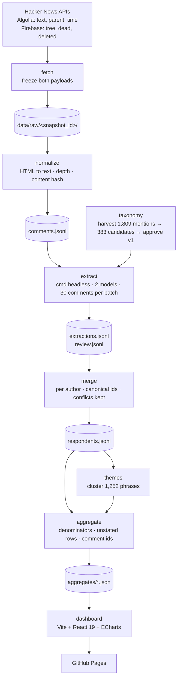
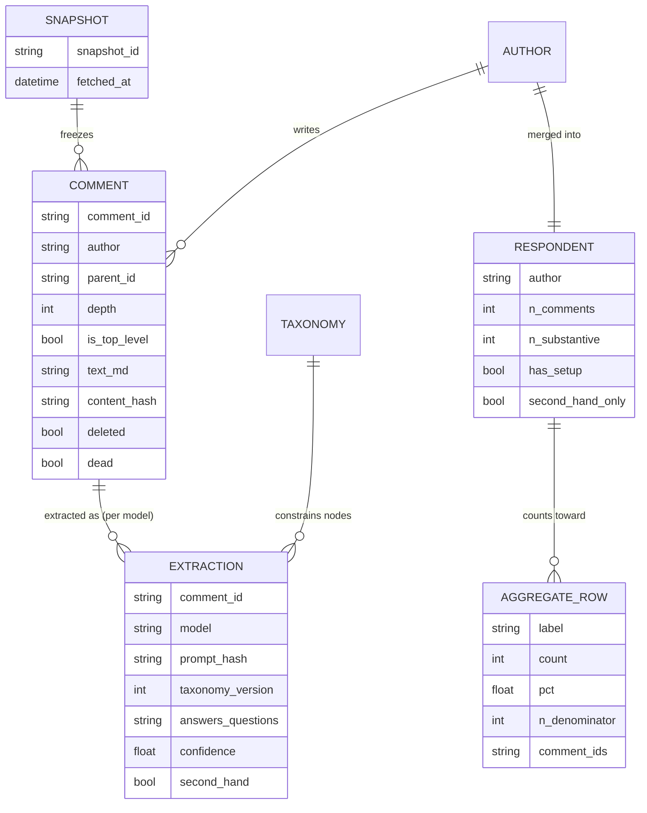
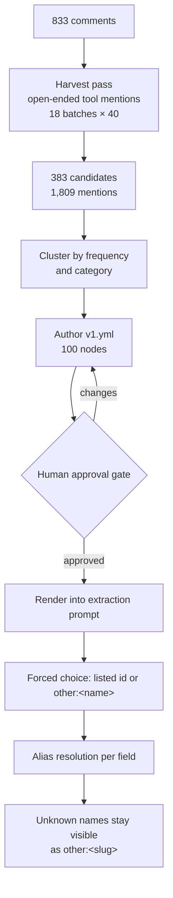
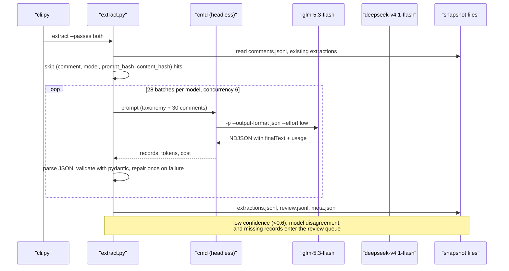
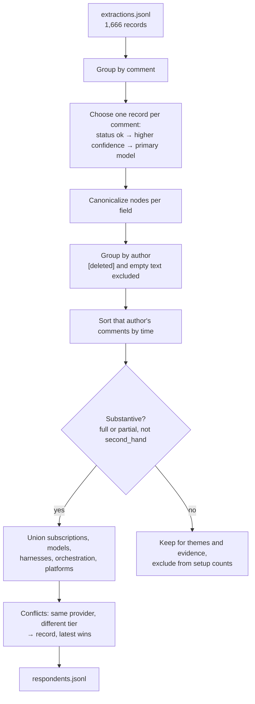
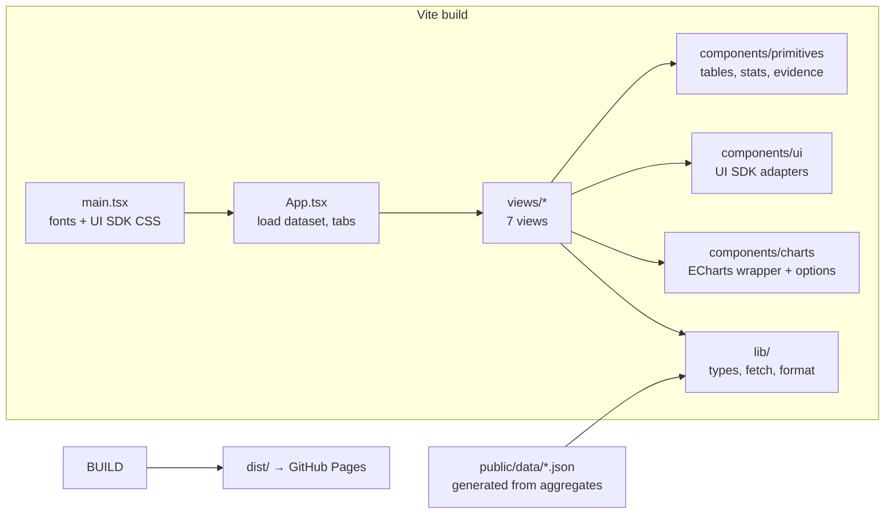
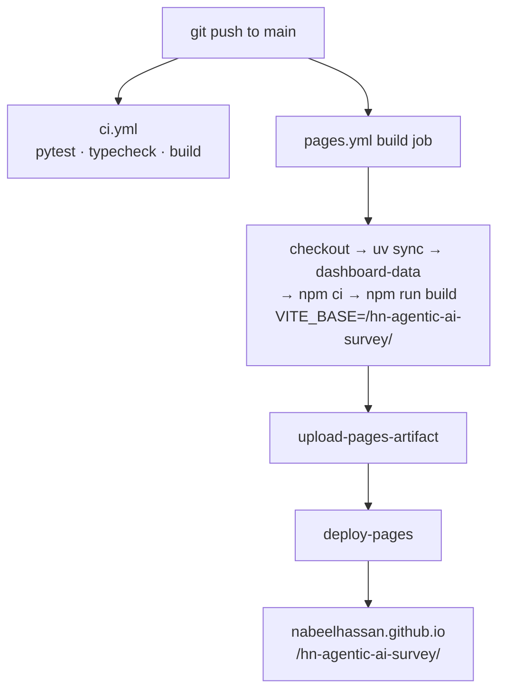
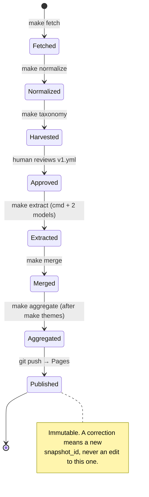

# Architecture

How a Hacker News thread becomes a traceable dataset and a static dashboard, end to end.

- Live dashboard: https://nabeelhassan.github.io/hn-agentic-ai-survey/
- Repository: https://github.com/Nabeelhassan/hn-agentic-ai-survey
- Current snapshot: `2026-11-15T182416Z`
- Glossary: [`CONTEXT.md`](../CONTEXT.md) · Method: [`METHODOLOGY.md`](./METHODOLOGY.md) · State: [`STATUS.md`](./STATUS.md)

---

## 1. What the system is for

The thread ["What's your current AI agentic setup?"](https://news.ycombinator.com/item?id=50366117) asks five questions: what people pay for, what models they use outside those subscriptions, which harnesses they drive, what orchestration they use, and which agent platforms they use. The answer space is fragmented across hundreds of comments, many of which are meta-commentary or describe someone else's setup.

The system turns that into:

1. **A frozen snapshot** of the thread, so numbers can be reproduced after the thread changes.
2. **A respondent-level dataset**, because one person's setup is spread across comments and one comment can describe a colleague.
3. **Aggregates where every number points back** to the comment ids that support it.
4. **A static dashboard** that requires no server, no database, and no hosting bill.

## 2. Design principles

| Principle | Consequence in the code |
| --- | --- |
| Snapshots are immutable | `data/raw/<snapshot_id>/` is never refetched or rewritten; corrections create a new snapshot. |
| The respondent is the unit | Per-comment records are merged per HN account before any setup count. |
| Provenance is not optional | Every aggregate row carries `n_denominator` and `comment_ids`; the UI links each id to its HN permalink. |
| Unstated is data | `unstated` is always a visible row and never dropped to make percentages sum. |
| Small samples do not get percentages | Below `n = 10` the UI prints counts, and `pct` is suppressed. |
| Method changes are versioned | `taxonomy_version`, `prompt_hash`, `model`, and `content_hash` travel with every derived record. |
| The model is not the authority | A hand-labelled gold set scores extraction, and the result is published on the Method tab. |

## 3. System context



## 4. Repository layout

```
.
├── CONTEXT.md                 glossary: respondent, harness, tier, snapshot…
├── AGENTS.md                  instructions for agents working in this repo
├── README.md                  what it is, commands, limitations
├── Makefile                   one target per pipeline stage
├── docs/
│   ├── ARCHITECTURE.md        this document
│   ├── METHODOLOGY.md         how the numbers are made
│   ├── STATUS.md              state of the current snapshot
│   └── adr/0001…0005          decisions and their alternatives
├── pipeline/
│   ├── pyproject.toml         uv project; httpx, pydantic, pyyaml
│   ├── uv.lock                pinned dependency graph
│   ├── prompts/
│   │   ├── extract_v1.md      per-comment extraction contract
│   │   ├── harvest_v1.md      open-ended tool-name harvest
│   │   └── themes_v1.md       theme clustering
│   ├── taxonomy/
│   │   ├── v1.yml             canonical vocabulary (100 nodes)
│   │   └── candidates.json    raw harvest output (383 candidates)
│   ├── src/hn_agents/         the pipeline modules (see §6)
│   └── tests/test_pipeline.py 5 tests over the rules that matter
├── data/
│   ├── raw/<snapshot>/        frozen Algolia, Firebase, story, fetch metadata
│   ├── snapshots/<snapshot>/  comments, extractions, respondents, review,
│   │                          theme map, eval, aggregates/, meta.json
│   └── eval/                  gold_v1.jsonl + report.json
├── dashboard/
│   ├── index.html
│   ├── vite.config.ts         base path from VITE_BASE
│   ├── public/data/           generated copy of aggregates (gitignored)
│   └── src/
│       ├── App.tsx            shell, data loading, tabs, error boundary
│       ├── views/             seven views
│       ├── components/ui/     UI SDK adapters
│       ├── components/charts/ ECharts wrapper + option builders
│       ├── components/        primitives (tables, evidence, stats)
│       └── lib/               types, fetch, formatting
└── .github/workflows/
    ├── ci.yml                 pipeline tests + dashboard typecheck/lint/build
    └── pages.yml              build from committed data → deploy to Pages
```

## 5. Data model



### Artifact fields

**`comments.jsonl`** — one row per fetched item.

| Field | Meaning |
| --- | --- |
| `comment_id`, `parent_id`, `story_id` | HN ids as strings |
| `author` | HN account, or `[deleted]` |
| `text_raw` / `text_md` | original HTML and normalized text |
| `created_at`, `created_at_i`, `updated_at` | timestamps from Algolia |
| `depth` | reply depth, computed locally, orphans treated as top-level |
| `is_top_level` | `parent_id == story_id` |
| `points` | always `null`: the HN API does not expose comment scores |
| `deleted`, `dead` | from Firebase |
| `content_hash` | SHA-256 of `text_md`, catches edits between snapshots |
| `label` | `algolia`, `both`, or `firebase_only` |

**`extractions.jsonl`** — one row per comment per model.

| Field | Meaning |
| --- | --- |
| `comment_id`, `model`, `run_id` | identity and provenance |
| `prompt_hash`, `taxonomy_version`, `schema_version`, `content_hash` | what produced it |
| `answers_questions` | `full`, `partial`, `none`, `meta`, `off_topic` |
| `q1_subscriptions[]` | `{node, tier_raw, count, confidence}` |
| `q1_multi_subscription` | `true`, `false`, or `null` |
| `q2_outside[]` | `{node, access: api/local/openrouter/other, purpose}` |
| `q3_harnesses[]` | `{node, role: primary/secondary, switched_from, switch_reason}` |
| `q4_orchestration[]` | `{node, description}` |
| `q5_platforms[]` | `{node, use_cases[]}` |
| `spend_monthly_usd` | number only when a monthly figure was stated |
| `second_hand` | describing someone else's setup |
| `evidence[]` | `{field, quote}` with quotes that must be substrings |
| `themes[]`, `confidence`, `status` | free-text, certainty, `ok`/`missing` |

**`respondents.jsonl`** — one row per author, merged:

`author`, `comment_ids[]`, `n_comments`, `n_substantive`, `answers {full, partial}`, `has_setup`, `second_hand_only`, `subscriptions[]`, `multi_subscription`, `outside_models[]`, `harnesses[]`, `orchestration[]`, `platforms[]`, `spend_monthly_usd`, `themes[]`, `theme_sources{}`, `conflicts[]`, `evidence[]`.

**`aggregates/*.json`** — nine files: `overview`, `subscriptions`, `models`, `harnesses`, `orchestration`, `themes`, `cooccurrence`, `explorer`, `methodology`. Every breakdown row is `{node, label, count, pct, n_denominator, comment_ids[]}`.

## 6. Stages

### 6.1 Fetch (`fetch.py`)

- **Algolia**: `GET /api/v1/search?tags=comment,story_50366117&hitsPerPage=1000&page=N` until `nbPages` is exhausted. Returns text, author, parent, timestamps, and `objectID`.
- **Firebase**: `GET /item/<id>.json` for the story, then a breadth-first walk of `kids` with a semaphore of 16 concurrent requests. Returns the authoritative tree including dead and deleted comments.
- Both run in one `asyncio.gather`; four attempts with exponential backoff on `429/5xx` and transport errors.
- Output: `data/raw/<snapshot_id>/{algolia.json, firebase-comments.json, story.json, fetch-meta.json}`.

Reconciliation for the first snapshot:

| Measure | Count |
| --- | --- |
| Algolia comments | 716 |
| HN `descendants` | 716 |
| Firebase nodes (excluding story) | 856 |
| Present in both | 716 |
| Firebase-only (dead/deleted, not indexed by Algolia) | 140 |

### 6.2 Normalize (`normalize.py`)

1. Decode HTML entities, turn `<a>` into `label (url)`, `<pre><code>` into fenced blocks, `<p>`/`<br>` into newlines, then strip remaining tags.
2. Collapse excess whitespace and blank lines.
3. Merge the two sources by id; attach `deleted`, `dead`, `points`.
4. Compute `depth` by walking `parent_id` with memoization. A reply whose parent is missing is depth 0, not depth 1 — that bug was caught by a test.
5. Hash the normalized text into `content_hash`.
6. Write `comments.jsonl` and record stats in `meta.json`.

First snapshot: 856 comments, 500 top-level, 659 authors, 23 deleted, 126 dead, max depth 9, 833 with text.

### 6.3 Taxonomy (`taxonomy.py`, `canonicalize.py`, `taxonomy/v1.yml`)

The vocabulary is grown from the thread rather than guessed, then frozen.



**Node schema** — a node may belong to several categories, because Cursor is a harness *and* a paid plan:

```yaml
- id: opencode
  label: OpenCode
  categories: [harness, subscription]
  aliases: [opencode, open code, opencode go, opencode go plus, opencode pro]
```

Current composition (100 nodes): subscriptions 21, harnesses 35, platforms 12, model routes 21, orchestration 13, named models 13.

**Field-aware canonicalization** (`canonicalize.py`) resolves the model's raw node string against only the categories valid for that field:

| Field | Allowed categories |
| --- | --- |
| `q1_subscriptions` | `subscription` |
| `q2_outside` | `model-source`, `model` |
| `q3_harnesses` | `harness` |
| `q4_orchestration` | `orchestration` |
| `q5_platforms` | `platform` |

Unresolved names become `other:<slug>`: spaces and punctuation collapse to hyphens, so `other:Grok CLI` and `other:grok-cli` cannot become two chart rows.

### 6.4 Extraction (`extract.py`, `cmdrun.py`, `models.py`)



- **Transport**: `cmd -p --output-format json --model <id> --effort low --max-turns 2 --skip-onboarding --trust`, prompt piped on stdin. Only the final `{"type":"result"}` frame is used; `usage` feeds the recorded cost.
- **Models**: `z-ai/glm-5.3-flash` and `deepseek/deepseek-v4.1-flash`. Both are pinned by id in `meta.json`.
- **Batching**: 30 comments per call, comments truncated at 6,000 characters, concurrency 6.
- **Validation**: `ExtractionBatch` → `CommentExtraction` (pydantic). One repair attempt with the validator error appended. Missing comment ids become `status: "missing"` records instead of being dropped.
- **Caching**: a record is reused only when comment id, model, `prompt_hash`, and `content_hash` all match. Records from a superseded prompt are discarded from the written file.
- **Review queue**: confidence below 0.6, cross-model signature mismatch, or a missing record.
- **Cost accounting**: per-model prices live in `cmdrun.PRICES_PER_MTOK`; input and output tokens are summed per run; the total is written to `meta.json` and rendered on the Method tab.

Actual first run:

| Model | Batches | Records | Input tokens | Output tokens | Cost |
| --- | --- | --- | --- | --- | --- |
| glm-5.3-flash | 28 | 833 | 976,586 | 231,518 | $0.2622 |
| deepseek-v4.1-flash | 28 | 833 | 626,955 | 385,576 | $0.3254 |
| **Total** | 56 | 1,666 | 1,603,541 | 617,094 | **$0.5876** |

### 6.5 Merge (`merge.py`)



- **Primary model** is `deepseek/deepseek-v4.1-flash`, chosen because it scored 0.90 on the gold set against glm's 0.73. Both models still run, because disagreement is a useful review signal.
- **Second-hand reports** are extracted but never counted: `second_hand_only` respondents exist in the file with `has_setup: false`.
- First snapshot: 659 author profiles, 413 with a stated setup, 6 second-hand-only, 1 with an internal conflict.

### 6.6 Themes (`themes.py`)

Extraction produces many unique phrases (1,252 in this snapshot). A clustering pass over `count<TAB>phrase` lines asks for 12–25 short labels, each input phrase assigned exactly once. The mapping is committed as `theme-map.json` and applied at aggregation time.

Result: 25 clusters, 49 phrases left unmapped and therefore kept as their own small labels instead of being forced into "other".

### 6.7 Aggregate (`aggregate.py`)

Every breakdown is built from unique respondents, with a fixed denominator and a mandatory `unstated` row:

```python
def _row(node, authors, comment_ids, denominator, labels):
    return {
        "node": node, "label": labels.get(node, node),
        "count": len(authors),
        "pct": round(100 * len(authors) / denominator, 1) if denominator else None,
        "n_denominator": denominator,
        "comment_ids": sorted(comment_ids),
    }
```

| File | Contents | Denominator |
| --- | --- | --- |
| `overview.json` | comments, commenters, respondents, answer-class distribution with ids, caveats | all comments with text |
| `subscriptions.json` | providers, tiers, multi-subscription split, stated spend buckets and values | respondents |
| `models.json` | routes, named model families, access mode, local share | respondents |
| `harnesses.json` | adoption, primary harness, migrations, migration pairs, switch reasons | respondents |
| `orchestration.json` | orchestration tools, platforms, use cases, orchestration users | respondents |
| `themes.json` | clustered themes with variant counts and evidence | respondents |
| `cooccurrence.json` | top 40 nodes and pairwise co-mentions (≥2) | respondents |
| `explorer.json` | one row per respondent for the table and dialog | respondents |
| `methodology.json` | taxonomy, extraction runs, normalization/merge stats, accuracy, conventions | n/a |

**Migration DAG.** Sankey requires a directed acyclic graph, but people moved both ways between the same harnesses. Aggregation therefore:

1. counts each `(from, to)` pair;
2. cancels reciprocal pairs to their net direction;
3. repeatedly drops the weakest edge that still creates a cycle, tracking how many moves that suppresses;
4. publishes every original pair in `migration_pairs` so nothing is hidden by the netting.

First snapshot: 42 stated moves, 35 distinct pairs, 17 net moves suppressed to keep the diagram acyclic.

**Co-occurrence** counts pairs of nodes that appear anywhere in one respondent's setup, which is how "Claude Max + Claude Code" or "Anthropic + OpenAI" show up as structure rather than two separate bars.

### 6.8 Validation (`validate.py`)

`data/eval/gold_v1.jsonl` holds 40 hand-labelled comments, stratified by length and reply depth. Evaluation compares the primary model field by field:

- exact accuracy for `answers_questions`;
- precision, recall, F1 per node field, with node ids normalized (`other:` slugs) on both sides;
- the mismatches themselves in `eval.json`, rendered on the Method tab.

First snapshot: **0.90** classification, F1 0.99 subscriptions, 0.75 models, 0.78 harnesses, 0.54 orchestration, 0.89 platforms. The weak field is stated on the dashboard, not buried.

## 7. Dashboard



| Concern | Choice | Why |
| --- | --- | --- |
| Framework | Vite 7 + React 19 + TypeScript | UI SDK requires React 19; Vite gives a static artifact |
| Styling | Tailwind 4 + CSS variables, dark only | matches the Shajra stack, no runtime CSS-in-JS |
| Interaction | `@ui-sdk/react` 0.1.0-beta.5 | accessible tabs, dialogs, segmented controls, inputs, switches — unstyled |
| Charts | ECharts 6 via `charts/Chart.tsx` | only library with first-class Sankey and heatmap |
| Data | runtime `fetch(BASE_URL + "data/*.json")` | the build has no data dependency; aggregates can change without a rebuild |
| Errors | `ErrorBoundary` around the tab surface | a failing chart previously blanked the page; now it shows the message and a retry |

**UI SDK isolation.** Every library part sits behind an adapter in `components/ui/`:

| Adapter | Library parts | Used by |
| --- | --- | --- |
| `tabs.tsx` | `Tabs`, `TabsList`, `TabsTab`, `TabsPanel` | the seven-view navigation |
| `segmented.tsx` | `SegmentedControl` + indicator | providers/tiers/spend, taxonomy filter |
| `dialog.tsx` | `Dialog`, `DialogBackdrop`, `DialogContent`, `DialogTitle`, `DialogClose` | respondent detail |
| `search.tsx` | `Input` | explorer search |
| `switch.tsx` | `Switch`, `SwitchThumb` | conflicts-only filter |

If the beta breaks a part, one adapter file changes and no view does.

**Views**

| View | What it shows | Interaction |
| --- | --- | --- |
| Overview | respondents vs commenters, answer-class coverage, snapshot provenance, gaps | — |
| Subscriptions | providers, tiers, multi-sub split, spend | segmented control |
| Models | routes, named models, access, local share | — |
| Harnesses | adoption, primary, net Sankey, every migration pair, switch reasons | search in captions |
| Platforms | orchestration, platforms, use cases, themes | filter chips |
| Explorer | one row per respondent, virtualized, keyboard focusable | search, conflict switch, detail dialog |
| Method | pipeline steps, accuracy, runs and cost, taxonomy, rules | taxonomy category filter |

**Explorer virtualization.** A fixed row height (52 px) and viewport (560 px) drive a manual window: only the visible slice plus eight overscan rows are mounted, with a spacer div preserving scroll height. Filtering and search run over all 413 respondents.

## 8. CI and deployment



- **No secrets in CI.** Extraction needs `cmd` and a logged-in account; CI never extracts. It tests, builds from committed aggregates, and deploys.
- **Base path.** The project page lives under `/hn-agentic-ai-survey/`, so `VITE_BASE` is set for both the CI build check and the Pages build. Without it, assets resolve from `/` and the page renders blank.
- **npm dev dependencies.** This machine's npm config has `omit=dev`, so local installs need `npm install --include=dev`; CI's `npm ci` installs them normally.
- **Permissions** in `pages.yml`: `contents: read`, `pages: write`, `id-token: write`, with the `github-pages` environment.

## 9. Snapshot lifecycle



Commands:

| Command | Reads | Writes |
| --- | --- | --- |
| `make fetch` | HN APIs | `data/raw/<id>/` |
| `make normalize` | raw | `comments.jsonl`, `meta.json` |
| `make taxonomy` | comments | `taxonomy/candidates.json` |
| `make extract` | comments, taxonomy, prompt | `extractions.jsonl`, `review.jsonl` |
| `make themes` | respondents | `theme-map.json` |
| `make merge` | extractions, taxonomy | `respondents.jsonl` |
| `make aggregate` | respondents, theme map, taxonomy | `aggregates/*.json` |
| `make eval` | extractions, gold set | `eval.json`, `data/eval/report.json` |
| `make dashboard-data` | aggregates | `dashboard/public/data/` |
| `make dev` / `make build` | dashboard sources | dev server / `dashboard/dist/` |

**Reproducibility.** A clone can rebuild every aggregate and the dashboard from committed files with no model calls and no network access, because `comments.jsonl`, `extractions.jsonl`, `theme-map.json`, and the taxonomy are all committed. Only `make fetch` needs the network, and only `make extract` needs `cmd` and a paid plan.

## 10. Cost and performance

| Operation | Time | Cost |
| --- | --- | --- |
| Fetch (716 + 856 requests) | under a minute | $0 |
| Harvest (18 batches) | ~27 min, concurrency 4 | ~$0.20 |
| Extraction, both models (56 batches) | ~11 min, concurrency 6 | **$0.5876** |
| Theme clustering (1 call) | under a minute | <$0.01 |
| Merge + aggregate | seconds | $0 |
| Dashboard build | ~6 s | $0 |
| Dashboard bundle | 973 kB JS, 101 kB CSS (325 kB / 16 kB gzip) | — |

The bundle is dominated by ECharts. Code-splitting the chart layer is the obvious next optimisation and is noted in [`STATUS.md`](./STATUS.md).

## 11. Decisions and trade-offs

| Decision | Alternative rejected | Record |
| --- | --- | --- |
| Immutable snapshots with raw payloads committed | a single live dataset refreshed in place | [ADR 0001](./adr/0001-immutable-snapshots.md) |
| Command Code headless for extraction | direct provider SDK + API key | [ADR 0002](./adr/0002-command-code-headless-extraction.md) |
| UI SDK for behaviour + ECharts for charts | a single component kit (no charts), or hand-built interactions | [ADR 0003](./adr/0003-ui-sdk-for-behaviour-echarts-for-charts.md) |
| Respondent as the counting unit | counting comment mentions | [ADR 0004](./adr/0004-respondent-as-primary-unit.md) |
| Static Pages build from committed JSON | a server, a database, or a hosted notebook | [ADR 0005](./adr/0005-github-pages-static-hosting.md) |

Further trade-offs worth knowing:

- **Two models instead of one.** Doubles extraction cost (to $0.59) and buys disagreement detection plus a fallback when one model regresses.
- **Hand-written gold set.** Forty labels is small; it measures the fields that matter and is honest about the rest. It is also the only reason the orchestration F1 of 0.54 is known.
- **Manual windowing instead of a virtualizer dependency.** UI SDK ships behaviours, not a table; 30 lines of scroll math beat another library.
- **Netting migrations.** The Sankey is a summary; the full pair table underneath is the record.
- **Per-field category canonicalization.** Slightly more code than a global alias map, but it stops "claude" in a harness field from becoming a subscription.

## 12. Extending it

**A second snapshot.** `make fetch` creates a new `<snapshot_id>` from the live thread. Re-extract with the same taxonomy and prompt to make usage comparable, or bump both deliberately and record the change in `meta.json`. Diff two snapshots by joining on `comment_id`; `content_hash` shows which comments were edited.

**A new question.** Add fields to `ExtractionBatch`/`CommentExtraction`, extend `prompts/extract_v1.md`, add the field to `FIELD_CATEGORIES` and the merge loop, then add an aggregate and a view. Bump `schema_version`.

**Taxonomy v2.** Copy `v1.yml`, edit, and pass `--taxonomy-version v2`. The extraction cache is keyed by prompt hash, which includes the rendered taxonomy, so v2 forces a clean re-extraction rather than mixing records.

**A new chart.** Add an option builder in `components/charts/options.ts`; it receives aggregate rows and returns a `EChartsCoreOption`. Keep the accessibility label and a table of the same numbers.

## 13. Known limitations

- Comment scores are not exposed by the HN API, so nothing is weighted by points; `points` is always `null`.
- Counts are per HN account: one person with two accounts counts twice, and throwaways count once.
- Orchestration is the weakest extraction field (F1 0.54); the model and the gold set disagree on where a custom harness ends and orchestration begins.
- Themes and organization names in the long tail land in `other:<slug>`; that is deliberate, but it means rare tools are visible rather than consolidated.
- The thread is live; the snapshot is a moment, and later comments are absent until a second snapshot exists.
- `dashboard/public/data/` is generated and gitignored; a fresh clone needs `make dashboard-data` before `npm run dev`.
- `validate.py` defaults to the deepseek model while `merge.py` and `aggregate.py` each name it separately. The three agree today; a single shared constant would be better.
